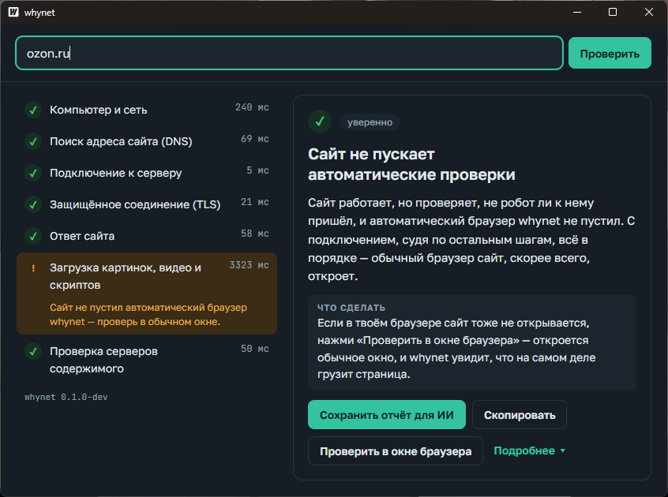

# whynet

**Why doesn't this site open?** whynet walks the path from your computer to the site, finds the step where it breaks and explains it in plain words, with the technical details one click away. Windows 10 / 11, one small `.exe`, no installation, no admin rights.

*Русский — ниже / Russian version below.*



## What it checks

1. **Your computer and network:** route to the internet, system proxy, `hosts` file, clock, VPN adapters, DPI-bypass tools (zapret, GoodbyeDPI, WinDivert) and whether the site is in their lists.
2. **DNS:** your resolver against an independent one (DNS-over-HTTPS), spoofing, fake-IP proxies on a router.
3. **Connection and TLS:** timeouts, resets, blocking by site name (DPI) found by comparing the real name with a neutral one on the same server, bad certificates, HTTPS-scanning antivirus.
4. **The page:** status, ISP block pages, geo-blocks, anti-bot checks.
5. **Content:** the page is opened in a hidden Edge/Chrome and every request is recorded. Each server the page loads from (images, video, scripts) is checked separately: ping, speed, freezes after the first ~16 KB, blocks. Ads and trackers are listed but never blamed.
6. **"Check in a browser window":** a plain browser window you use yourself (pass a bot check, log in, play a video) while whynet records what it loads.

About 30 diagnoses, each with a plain explanation and what to do. When whynet can't tell, it says "probably" and why.

## The AI report

One button saves everything whynet learned into a single Markdown file with an instruction for the AI at the top. Drop it into ChatGPT or Claude and ask nothing: you get an analysis. Your public IP, computer name and Windows user name are hidden by default; you see exactly what goes into the file before saving, and can switch hiding off.

## Download and use

Take `whynet.exe` from the [Releases](../../releases) page and run it. Windows may show an "unknown publisher" warning: the exe is not code-signed. whynet needs Edge or Chrome only for the content checks (Edge ships with Windows 10/11).

## Privacy

whynet sends nothing anywhere except what a check needs: DNS-over-HTTPS lookups of the checked domain (1.1.1.1, 8.8.8.8), a request to Cloudflare to learn your public IP and provider, and the page itself. No telemetry. The hidden browser uses a throwaway profile with sign-in and sync switched off, deleted afterwards.

## Build from source

Needs Go, Node.js and [Wails v2](https://wails.io).

```
go test ./...                              # tests, including a lab of simulated failures
go run ./cmd/whynet-cli -save youtube.com  # console version, saves the AI report
wails build                                # build/bin/whynet.exe
```

The code is split into probes (collect facts), rules (`rules/diagnoses.yaml` turn facts into a diagnosis) and texts (`locales/ru.yaml`). See [CLAUDE.md](CLAUDE.md) and [docs/](docs/): design, architecture, the catalog of diagnoses, known pitfalls.

## Credits and licenses

MIT, see [LICENSE](LICENSE). Built with [Wails](https://wails.io). The ad and tracker list is [StevenBlack/hosts](https://github.com/StevenBlack/hosts) (MIT, `rules/ads-LICENSE.txt`). Fonts Golos Text and JetBrains Mono (SIL OFL) are bundled via Fontsource.

---

# whynet (по-русски)

**Почему не открывается сайт?** whynet проходит путь от твоего компьютера до сайта, находит, где он рвётся, и объясняет простыми словами. Технические подробности — под кнопкой «Подробнее». Windows 10 / 11, один небольшой `.exe`, без установки и прав администратора.

## Что проверяет

1. **Компьютер и сеть:** выход в интернет, системный прокси, файл `hosts`, часы, VPN-адаптеры, программы обхода блокировок (zapret, GoodbyeDPI, WinDivert) и есть ли сайт в их списках.
2. **DNS:** твой DNS против независимого (DNS-over-HTTPS), подмена адреса, fake-IP прокси на роутере.
3. **Подключение и TLS:** тайм-ауты, сбросы, блокировка по имени сайта (DPI), плохие сертификаты, антивирус с проверкой HTTPS.
4. **Страница:** код ответа, заглушки провайдера, геоблокировка, проверка на робота.
5. **Содержимое:** страница открывается в невидимом Edge/Chrome, записывается каждый запрос. Каждый сервер, с которого грузятся картинки, видео и скрипты, проверяется отдельно: пинг, скорость, замирание после первых ~16 КБ, блокировки. Реклама и счётчики видны, но виноватыми не считаются.
6. **«Проверить в окне браузера»:** обычное окно браузера, которым пользуешься ты сам (пройти проверку на робота, войти в аккаунт, включить видео), пока whynet записывает, что грузит страница.

Около 30 диагнозов, у каждого понятное объяснение и совет. Если уверенности нет, whynet так и говорит: «скорее всего» и почему.

## Отчёт для ИИ

Одна кнопка сохраняет всё, что узнал whynet, в один Markdown-файл с инструкцией для нейросети наверху. Перетащи файл в чат с ChatGPT или Claude, ничего не пиши — получишь разбор. Внешний IP, имя компьютера и имя пользователя по умолчанию скрыты; перед сохранением видно, что попадёт в файл, и скрытие можно отключить.

## Скачать и запустить

Скачай `whynet.exe` на странице [Releases](../../releases) и запусти. Windows может показать предупреждение «неизвестный издатель»: exe не подписан. Edge или Chrome нужны только для проверки содержимого (в Windows 10/11 Edge есть).

## Приватность

whynet ничего не отправляет, кроме нужного для проверки: DNS-over-HTTPS-запросы про проверяемый домен (1.1.1.1, 8.8.8.8), запрос к Cloudflare, чтобы узнать внешний IP и провайдера, и сама страница. Телеметрии нет. Невидимый браузер работает во временном профиле без входа в аккаунт и синхронизации, профиль удаляется.

## Сборка из исходников

Нужны Go, Node.js и [Wails v2](https://wails.io). Команды выше. Документация по устройству — в [docs/](docs/) (на английском).

Лицензия MIT, см. [LICENSE](LICENSE).
